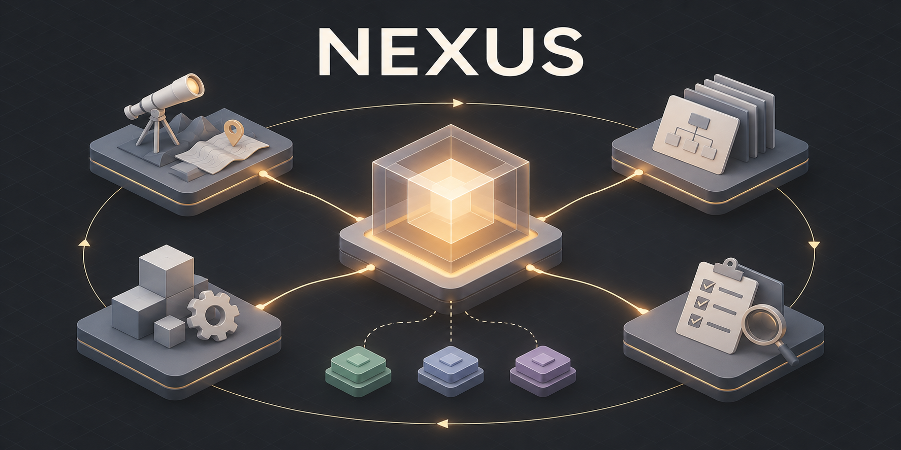

# NEXUS — Engineering Intelligence

[](https://github.com/elourenco/nexus-skill/actions/workflows/validate.yml)
[](https://github.com/elourenco/nexus-skill/releases)
[](skills/nexus/SKILL.md)
[](#começar)

**Dê ao seu agente de IA um workflow de engenharia: entender, planejar, implementar e validar.**

Portable AI engineering skills for Claude Code and OpenAI Codex.

[Começar](#começar) · [Exemplos](#experimente-no-seu-projeto) · [Skills](#entradas-disponíveis) · [Como funciona](#criar-ou-alterar-uma-feature-por-aceites) · [Apoiar](#ajude-a-evoluir-o-nexus)



## Da ideia ao código, com decisões que você consegue revisar

Seu agente começa a implementar antes de entender o problema? Uma alteração pequena
vira uma refatoração enorme? A resposta diz “pronto”, mas você ainda precisa descobrir
o que foi testado?

**NEXUS organiza esse trabalho em seis skills**, da exploração ao code review.
Você descreve o objetivo; o agente é orientado a explicitar decisões, executar o
escopo autorizado e apresentar evidências de validação. Use o fluxo completo para
uma feature ou entre diretamente em planejamento, implementação, diagnóstico e revisão.

| Quando você precisa… | O NEXUS orienta o agente a… |
| --- | --- |
| Transformar uma ideia em uma feature | Entender o problema, comparar alternativas e definir critérios de aceite antes da implementação |
| Fazer uma alteração pontual | Ajustar a profundidade ao risco, com referências e artefatos somente quando úteis |
| Tomar uma decisão de arquitetura | Examinar contratos, latência, throughput, concorrência e recuperação de falhas |
| Investigar um bug | Reunir evidências, testar hipóteses e distinguir diagnóstico de correção validada |
| Revisar uma entrega | Apresentar achados, verificações executadas, limitações e pendências |

O núcleo é textual, usa as ferramentas do seu agente e carrega referências sob
demanda. **Para começar, você não precisa de Python, servidor ou banco de dados.**
Memória, workflows, hooks e runtime textual são componentes locais opcionais.

## Começar

### Experimente por leitura direta

Clone o repositório:

```sh
git clone https://github.com/elourenco/nexus-skill.git
cd nexus-skill
```

No seu agente, carregue [skills/nexus/SKILL.md](skills/nexus/SKILL.md) a partir do
checkout e indique o projeto que quer analisar. Se estiver em outro diretório,
informe o caminho absoluto para esse arquivo. Faça um primeiro pedido:

> Use NEXUS para analisar a arquitetura deste projeto. Identifique um risco relevante,
> explique as evidências e recomende o próximo passo. Somente análise, sem alterar arquivos.

Confira se a resposta aponta fontes do projeto, explicita incertezas e propõe uma
ação verificável. Essa é uma primeira forma de avaliar a skill no seu contexto.

### Instale como plugin

Para acompanhar versões publicadas, escolha seu host. A branch **`plugins`** é
gerada pelo CI após cada release, com a mesma versão nos dois manifestos. Ela
precisa existir no remoto antes da primeira instalação. O catálogo mantém o nome
**`nexus-local`** por compatibilidade, mesmo quando sua origem é remota.

Os catálogos de `main` também encaminham para `plugins`, evitando instalar a
versão de desenvolvimento por engano. Para fixar uma versão, use a tag de
pacote **`plugin-vX.Y.Z`** no lugar de `plugins` nos comandos abaixo. As tags
`vX.Y.Z` identificam o código-fonte e não são referências de instalação fixada.
As tags de pacote são criadas pelo novo fluxo; use somente referências existentes.
Versões antigas não recebem essas tags em massa.

**Claude Code**

```sh
claude plugin marketplace add https://github.com/elourenco/nexus-skill.git#plugins
claude plugin install nexus@nexus-local
```

**Codex**

```sh
codex plugin marketplace add https://github.com/elourenco/nexus-skill.git --ref plugins
codex plugin add nexus@nexus-local
```

No Claude, habilite `/plugin` → **Marketplaces** → **nexus-local** →
**Enable auto-update**. No Codex, atualize explicitamente com
`codex plugin marketplace upgrade nexus-local` e `codex plugin add nexus@nexus-local`;
não há garantia documentada de polling automático para esse canal.

Para testar alterações locais, gere um pacote com
`python3 scripts/verify_hosts.py --prepare-local /tmp/nexus-dev-candidate` e
registre esse diretório como marketplace. Ele precisa ser novo a cada geração.
Registrar a raiz de `main` instala a release publicada. Instalações existentes
que apontem para `main` precisam atualizar o catálogo e o plugin; checkouts locais
precisam migrar a origem uma vez;
o [guia de instalação](skills/nexus/references/installation.md) descreve o procedimento.

Abra uma nova sessão **no projeto em que você quer trabalhar**, confira as seis
entradas no seletor e invoque uma delas no chat:

| Host | Primeiro pedido |
| --- | --- |
| Claude Code | `/nexus:start Analise a arquitetura deste projeto, sem alterar arquivos.` |
| Codex | `$nexus:nexus Analise a arquitetura deste projeto, sem alterar arquivos.` |

A disponibilidade dos comandos depende do cliente instalado. Se `plugin` não
existir ou as entradas não aparecerem, siga o [guia de instalação e verificação](skills/nexus/references/installation.md)
ou use o carregamento direto. O plugin compartilha o mesmo núcleo entre os dois
hosts; helpers e runtime continuam opt-in. Veja a [avaliação de descoberta nos hosts](docs/behavioral-evaluation.md).

O ícone **núcleo conectado** fica em [skills/nexus/assets/nexus-icon.png](skills/nexus/assets/nexus-icon.png).
O Codex o referencia no plugin e nos metadados das seis skills. No Claude, o
campo `icon` atende ao catálogo da Anthropic; o Claude Code não o exibe no terminal.
Veja a [validação do ícone](docs/plugins-validation.md#ícone-núcleo-conectado-2026-11-03).

No Codex, o plugin usa o subtítulo **Da ideia à entrega validada**, com três
pedidos iniciais: especificar uma funcionalidade, investigar uma falha e revisar
um diff. As seis skills têm nomes consistentes, descrições curtas em português
e o mesmo ícone, com uma cópia idêntica em cada skill para manter caminhos locais.

| Entrada | Descrição no seletor do Codex |
| --- | --- |
| NEXUS | Da ideia à entrega validada |
| NEXUS Brainstorming | Explore ideias e defina critérios de aceite |
| NEXUS Plan | Planeje etapas, contratos e dependências |
| NEXUS Build | Implemente incrementos com validação e evidências |
| NEXUS Debug | Investigue falhas e confirme a causa raiz |
| NEXUS Review | Revise diffs, contratos e riscos de regressão |

Os dois manifestos apontam para o [repositório](https://github.com/elourenco/nexus-skill)
e identificam o publicador como NEXUS. O Website do Codex usa
`interface.websiteURL`; documentação e suporte no diretório Anthropic usam
`documentationUrl` e `supportUrl`. O suporte aponta para as
[issues](https://github.com/elourenco/nexus-skill/issues).
Veja os [resultados e limites da validação](docs/plugins-validation.md#metadados-de-apresentação-2026-11-03).

## Experimente no seu projeto

Depois de carregar o NEXUS, use um destes pedidos em linguagem natural. Adapte o
escopo ao seu projeto; são exemplos de uso, não resultados de benchmark.

**Planejar uma feature**

> Use nexus-brainstorm para desenhar a exportação CSV do relatório de pedidos.
> Considere grandes volumes, permissões e retomada após falha. Primeiro apresente
> a solução e os critérios de aceite para eu revisar.

**Decidir uma arquitetura**

> Use nexus-plan para planejar a sincronização offline do aplicativo. Preserve os
> contratos atuais e detalhe conflitos, idempotência, retries e observabilidade.
> Ainda não implemente.

**Investigar um bug**

> Use nexus-debug para investigar por que este job processa o mesmo evento duas
> vezes. Busque uma reprodução, avalie a concorrência e apresente as evidências
> da causa antes de propor a correção.

**Revisar antes de integrar**

> Use nexus-review para revisar este diff. Priorize regressões de contrato,
> autorização, concorrência e recuperação. Aponte arquivo, impacto e verificação
> recomendada para cada achado.

Você pode usar somente a etapa de que precisa. Os perfis **FAST**, **BALANCED** e
**DEEP** ajustam a profundidade ao risco e à incerteza; não fixam um modelo nem
exigem múltiplos agentes.

## Entradas disponíveis

| Entrada | Quando usar | Entrega |
| --- | --- | --- |
| [nexus](skills/nexus/SKILL.md) | Coordenação geral, status ou retomada | Roteamento ou estado reconciliado |
| [nexus-brainstorm](skills/nexus-brainstorm/SKILL.md) | Iniciar uma feature ou explorar alternativas | Fluxo guiado por aceites; recomendação quando o pedido for só explorar |
| [nexus-plan](skills/nexus-plan/SKILL.md) | Detalhar uma direção definida | Contratos, etapas, dependências e validação |
| [nexus-build](skills/nexus-build/SKILL.md) | Implementar o escopo autorizado | Alterações verificadas e pendências |
| [nexus-debug](skills/nexus-debug/SKILL.md) | Investigar bug ou comportamento inesperado | Diagnóstico; correção quando solicitada |
| [nexus-review](skills/nexus-review/SKILL.md) | Avaliar diff, contrato ou solução existente | Achados com evidências e decisão de review |

“Brainstorming do NEXUS sobre sincronização offline” e “Use NEXUS para fazer
brainstorming sobre sincronização offline” selecionam o mesmo procedimento.
Brainstorming e planejamento não autorizam implementação; “revise e corrija” pode
percorrer Review e Build dentro do escopo já autorizado. FAST/BALANCED/DEEP continuam
sendo perfis de profundidade, sem criar variações de comandos. Status e retomada
continuam em `nexus`, sem entradas adicionais.

O [índice de rotas](skills/nexus/references/routes.md) distingue destinos obrigatórios,
expansões por gatilho e referências informativas. Status com fontes suficientes
encerra no estado e nos gates; review carrega um contrato curto de critérios, sem
percorrer o registry de agentes. Entradas especializadas seguem diretamente aos
destinos, reutilizando leituras da mesma revisão. Isso reduz conteúdo obrigatório;
ganhos de latência e tokens dependem de avaliação de execução.

No plugin Claude Code, a marca já está no namespace:

| Ação | Claude Code | Codex standalone |
| --- | --- | --- |
| Iniciar ou retomar | `/nexus:start` | `$nexus` |
| Explorar | `/nexus:brainstorm` | `$nexus-brainstorm` |
| Planejar | `/nexus:plan` | `$nexus-plan` |
| Implementar | `/nexus:build` | `$nexus-build` |
| Diagnosticar | `/nexus:debug` | `$nexus-debug` |
| Revisar | `/nexus:review` | `$nexus-review` |

No Codex, os títulos no app são **NEXUS**, **NEXUS · Brainstorm**, **NEXUS · Plan**,
**NEXUS · Build**, **NEXUS · Debug** e **NEXUS · Review**. O cliente pode qualificar
os nomes de skills instaladas como plugin: por exemplo, `$nexus:nexus-plan`.
Selecione a entrada oferecida pelo host. Os nomes globais continuam `nexus-*`.

Os procedimentos e políticas vivem em `skills/nexus/`. As cinco entradas são
seletores curtos com referências relativas ao núcleo; não duplicam workflow,
estado ou regras. A [invocação](skills/nexus/references/invocation.md) carrega apenas
o procedimento escolhido e executa no agente atual por padrão.

### Criar ou alterar uma feature por aceites

Comece por `nexus-brainstorm` e descreva a feature. O agente conduz entendimento,
solução, plano, implementação, validação e review, sem exigir novas invocações.

> nexus-brainstorm: quero adicionar exportação CSV ao relatório de pedidos.

Leia a solução e peça ajustes ou responda “aprovado” para seguir ao plano. O agente
explicita o efeito de cada aceite. Ao apresentar o plano, oferece **subagentes** ou
**agente único**, recomenda uma opção conforme a tarefa e informa limitações reais.
Por exemplo: “Aprovo o plano; implemente com subagentes” ou “Aprovo; agente único”.
Se a escolha estiver pendente, aprovar o plano não seleciona um método implicitamente.
Escolhas e autorizações suficientes já fornecidas são preservadas.

Com subagentes, a sessão ativa orquestra contextos novos por tarefa quando o host
suporta; os workers enviam dúvidas e resultados ao orquestrador, que integra e
valida. Contextos separados não isolam arquivos/bancos/portas: paralelismo exige
recursos isolados. Esses contextos não implicam chats visíveis ou persistentes.
No modo agente único, a sessão implementa em sequência sem criar workers; gates
de review independente continuam exigindo cobertura real e acordo sobre o revisor.

Após o aceite para executar, o agente implementa, testa e revisa no escopo local,
voltando ao usuário somente por decisão material ou bloqueio indispensável.
“Somente explorar” e “somente planejar” encerram o fluxo na entrega solicitada.
Commit, push, merge e deploy exigem autorização correspondente. Artefatos e helpers
continuam opcionais; confira o [contrato do fluxo](skills/nexus/references/brainstorming.md#fluxo-guiado-por-aceites)
e os [métodos de execução](skills/nexus/references/agents.md#metodo-de-execucao).

<details>
<summary>Como o NEXUS apresenta progresso, decisões e evidências</summary>

As seis entradas compartilham um [contrato de apresentação](skills/nexus/references/chat.md):
situação atual, tarefas, decisões pendentes, evidências e próxima ação, conforme
a necessidade. O agente usa listas, perguntas estruturadas, diffs e detalhes
expansíveis quando o host os disponibiliza e permite; texto portátil mantém
o conteúdo essencial quando algum recurso falta. Perguntas simples continuam diretas.

A seleção considera as capacidades da sessão, não apenas a marca do provedor.
O contrato não instala uma UI nem promete painel persistente, botões ou atualização
ao vivo em todos os hosts. A apresentação usa a fonte de estado existente e
reconcilia ações desatualizadas ou de resultado incerto antes de repetir efeitos.
Veja os [cenários e limites de validação](docs/guided-chat-validation.md).

</details>

## Ajude a evoluir o NEXUS

**O NEXUS foi útil no seu projeto? Deixe uma estrela no [repositório](https://github.com/elourenco/nexus-skill)**
para apoiar o projeto e encontrá-lo novamente.

- **Conte o que funcionou:** compartilhe um caso de uso, o host utilizado e o que
  você precisou ajustar em uma [issue](https://github.com/elourenco/nexus-skill/issues).
- **Encontrou uma falha?** Inclua a entrada utilizada, o comportamento esperado
  e uma reprodução mínima, sem segredos ou dados privados do seu projeto.
- **Tem uma melhoria?** Proponha um exemplo, correção de documentação ou mudança
  de workflow com um problema concreto e um critério de aceite.

Relatos reproduzíveis ajudam a avaliar onde a skill funciona e onde precisa melhorar.
Para acompanhar versões, consulte as [releases](https://github.com/elourenco/nexus-skill/releases).

## Instalação e invocação por host

<details>
<summary>Instalação manual, sintaxe por host e verificação de descoberta</summary>

O Codex usa diretamente `skills/`. O pacote Claude é gerado a partir dessas
fontes com nomes curtos, sem manter cópias manuais dos procedimentos. Na instalação
manual de skills standalone, copie **as seis pastas** de `skills/` para o mesmo diretório
de skills suportado pelo host, preservando nomes e conteúdo. `nexus/` deve ficar
ao lado de `nexus-brainstorm/`, `nexus-plan/`, `nexus-build/`, `nexus-debug/` e
`nexus-review/`. Atualize o conjunto a partir da mesma revisão para preservar os
contratos. Antes de substituir uma instalação, confira alterações locais.

Para instalação mínima, copie somente `skills/nexus/`; os pedidos em linguagem
natural continuam disponíveis. Uma entrada especializada isolada é incompleta:
se faltar o núcleo ou a referência exigida, o agente informa a dependência e
interrompe esse fluxo. Não há instalador nem atualização global automática.

| Host / instalação | Exemplo após instalação e descoberta |
| --- | --- |
| Codex CLI / IDE — standalone | `$nexus-brainstorm Compare as alternativas de sincronização offline.` |
| Claude Code — standalone | `/nexus-brainstorm Compare as alternativas de sincronização offline.` |
| Codex — plugin `nexus` | `$nexus:nexus-brainstorm Compare as alternativas de sincronização offline.` |
| Claude Code — plugin `nexus` | `/nexus:brainstorm Compare as alternativas de sincronização offline.` |
| Outros hosts / carregamento manual | Carregue a entrada e peça “Use nexus-brainstorm para comparar as alternativas”. Verifique o mecanismo de seleção do host. |

No Codex, skills de repositório podem ficar em `.agents/skills/`; no Claude Code,
em `.claude/skills/`. Essas sintaxes são interfaces dos hosts, não subcomandos de
uma CLI NEXUS. Confira a documentação de [skills no Codex](https://learn.chatgpt.com/docs/build-skills)
e [skills no Claude Code](https://code.claude.com/docs/en/skills).

Após copiar, verifique que o host lista as seis entradas e invoque uma com um
pedido apenas de análise. Confira a leitura do procedimento e o escopo respeitado.
A presença dos arquivos não prova descoberta automática ou acesso aos links entre
pastas em qualquer host. Este repositório não modifica configurações globais.

</details>

## Componentes e fronteiras

O núcleo em **`skills/nexus/` é a fonte de verdade**. As cinco entradas especializadas reutilizam seus procedimentos e políticas. Os componentes executáveis abaixo são opcionais e têm escopos distintos.

| Componente | Responsabilidade | Ativação e limites |
| --- | --- | --- |
| [Skill portátil](skills/nexus/SKILL.md) | Instruções, procedimentos, políticas e templates | Carregada pelo agente; execução nas ferramentas do host |
| [Memória local](skills/nexus/references/memory.md) | Store JSON com proveniência, isolamento e recuperação | Helper opt-in; sem persistência automática |
| [Workflow local](skills/nexus/references/workflow-state.md) | Tarefas, DAG, gates, recibos e recuperação | CLI opt-in; sem scheduler ou dispatch automático |
| [Hooks locais](skills/nexus/references/hooks.md) | Checks, permissões, recibos e journal SQLite | Executor opt-in; registro e escopo definidos pelo consumidor |
| [Runtime textual](runtime/README.md) | Roteamento, adapters textuais e Council de review | Componente separado; não instala agentes no host |

Não há dashboard ou ligação automática entre esses componentes. Implementação, testes do projeto consumidor e dispatch do workflow continuam nas ferramentas reais do host. A memória JSON do projeto e o journal SQLite dos hooks são stores separados, sem sincronização automática.

## Segurança, ética e autorização

[Segurança e ética em IA](skills/nexus/references/ai-safety-ethics.md) orientam tanto
a atuação da NEXUS quanto os produtos com IA que ela ajuda a construir: autorização,
privacidade, confiabilidade, impacto humano e supervisão proporcional ao risco.
As regras vivem em [Policies](skills/nexus/references/policies.md#policy-ai-safety-ethics)
e chegam às seis entradas pelos contratos compartilhados, com detalhes sob demanda.
São instruções e critérios de avaliação; não instalam barreiras técnicas, certificam
conformidade ou comprovam resistência a prompt injection.

A skill não concede permissão para commit, push, merge, deploy ou outras ações externas. O [registro de validação](docs/ai-safety-ethics-validation.md) distingue verificações estruturais, aplicação documental dos cenários e limites da entrega.

## Referências

<details>
<summary>Mapa dos módulos e documentação avançada</summary>

| Caminho | Responsabilidade |
| --- | --- |
| [Skill](skills/nexus/SKILL.md) | Entrada curta e seleção de referências |
| [Workflow](skills/nexus/references/workflow.md) | FAST/BALANCED/DEEP, Explore/Plan/Build/Review e Autonomous |
| [Todo executável](skills/nexus/references/workflow-state.md) | Store local, orquestração, CLI/Markdown e limites do runtime |
| [Políticas](skills/nexus/references/policies.md) | Testes adaptativos, contexto e modelos |
| [Segurança e ética em IA](skills/nexus/references/ai-safety-ethics.md) | Conduta do agente, impacto humano nos produtos, controles e evidências proporcionais |
| [Agentes](skills/nexus/references/agents.md) | Ownership e revisão por pilar |
| [Hooks](skills/nexus/references/hooks.md) | Executor local opt-in, permissões, recibos e recuperação |
| [Memória](skills/nexus/references/memory.md) | Persistência local opt-in, proveniência, recuperação e isolamento |
| [Helper de memória](skills/nexus/scripts/memory.py) | CLI Python sem dependências; filesystem local POSIX |
| [Decisões e hipóteses](skills/nexus/references/cognitive.md) | Premissas, alternativas e evidências |
| [Modelagem](skills/nexus/references/domain-design.md) | Estados, fronteiras e ownership proporcionais à mudança |
| [Design arquitetural](skills/nexus/references/architecture-design.md) | Interfaces, diagnóstico de dependências, decisões de sistema/solução e padrões condicionais |
| [Refatoração](skills/nexus/references/refactoring.md) | Transformações incrementais, caracterização e preservação de contratos/efeitos |
| [Fontes de design](skills/nexus/references/design-sources.md) | Proveniência e adaptações das quatro skills e dos padrões de refatoração; sem dependência externa |
| [Pacote de review](skills/nexus/references/review-package.md) | Coleta Git com hashes, anexos e limites explícitos |
| [Templates](skills/nexus/assets/templates/spec.md) | Spec, plano, tarefa, ADR e memória |
| [Escopo](docs/phase-1.md) | Entrega atual e próximos refinamentos |

</details>

## Validar

O [CI/CD](docs/releases.md) executa essas verificações em PRs e pushes. Cada push
na branch principal (`main`, ou `master` se renomeada) publica uma release com tag
`vX.Y.Z` após os testes, incluindo os PRs integrados desde a versão anterior.

Para adotar os componentes locais, siga o [consumidor mínimo](skills/nexus/references/consumer-guide.md).
O exemplo executável demonstra falha, bloqueio, correção e recuperação com recibos
reais. Os [checks de qualidade](skills/nexus/references/quality-checks.md) reutilizam
o executor de hooks com flags, escopo e thresholds definidos pelo consumidor.

A [suíte comportamental](docs/behavioral-evaluation.md) separa descoberta nos hosts,
aplicação por agentes e testes dos helpers. `scripts/evaluate.py` prepara condições
baseline/NEXUS com contextos independentes, registra observações reais e mantém
amostras ausentes como inconclusivas; não inicia inferência nem inventa métricas.

O workflow aceita uma política opcional de [recibos dos hooks](skills/nexus/references/workflow-state.md):
importação explícita, vínculo a tarefa/run/snapshot e revalidação na conclusão.
Consumidores antigos continuam usando o contrato declarado. Identidades de review
são proveniência informada pelo host, não autenticação de independência.

Na raiz do repositório, com **Python 3.10+**, sem dependências Python externas. Os helpers locais exigem POSIX; o uso textual da skill não depende desse ambiente:

```sh
python3 scripts/validate.py
python3 skills/nexus/scripts/hook_engine.py validate
python3 -m unittest discover -s tests -v
```

<details>
<summary>Cobertura, evidências e limites das verificações</summary>

O validador cobre metadados das seis entradas, links Markdown locais e contratos dos manifestos/catálogos. Os testes de pacote verificam dependências ausentes e portabilidade do núcleo isolado e do conjunto. As [evidências das entradas](docs/entrypoints-validation.md) registram avaliações comportamentais com cenários sintéticos e seus limites. A suíte em `tests/` exercita memória, workflows, hooks e relocação dos helpers, incluindo persistência, concorrência e recuperação. Veja as [evidências de memória](docs/memory-validation.md), a [auditoria de workflows](docs/workflow-implementation.md), suas [evidências](docs/workflow-validation.md) e a [validação de plugins](docs/plugins-validation.md). Os testes Python não demonstram aderência geral de agentes nem substituem a instalação nos hosts.

Para o runtime textual opcional, execute `python3 -m unittest discover -s runtime/tests -v`. Os testes usam dados sintéticos e HTTP em loopback; não exigem credenciais nem comprovam acesso autenticado a providers. Veja [escopo e limites](runtime/README.md) e o [desenho do incremento](docs/agents-review-runtime-design.md).

As [evidências da base](docs/validation.md) e os documentos da fase 1 registram o estágio documental anterior; os incrementos executáveis têm escopo nas referências acima.

Consulte os [limites do executor de hooks](skills/nexus/references/hooks.md) e suas [evidências](docs/hooks-validation.md) antes de conceder permissões. O registro padrão valida este repositório; consumidores configuram ferramentas e arquivos que compõem os recibos. A memória SQLite dos hooks é isolada da memória JSON do projeto; não existe sincronização automática.

As [evidências do incremento 0.3.0](docs/quality-improvements-validation.md) mapeiam
as entregas aos testes, ao review independente e aos limites das avaliações.

O fluxo distingue **perfil de risco** de **acompanhamento direto ou rastreado**:
uma entrega local pode usar chat, diff e verificações sem criar TASK/SPEC/PLAN;
retomadas reutilizam o estado e o plano aprovados. A CLI opt-in mantém seus gates.
A [suíte de eficiência](evals/efficiency-suite.json) e o
[comparador de versões](docs/behavioral-evaluation.md)
avaliam artefatos desnecessários, preservação das validações e consumo observado.
Consulte os [resultados e limites](docs/efficiency-validation.md) antes de inferir economia.

A [integração de design e refatoração](docs/design-refactoring-validation.md)
registra fontes, roteamento sob demanda e aplicação em nove cenários sintéticos.
A [suíte específica](evals/design-refactoring-suite.json) usa o mesmo harness;
seus resultados distinguem recuperação de orientação, avaliação de respostas e
garantias de runtime ainda não verificadas.

</details>

## Origem e distribuição

O desenho parte de práticas de desenvolvimento orientado por especificação, execução persistente com limites e arquitetura proporcional ao risco. Superpowers e UB-Mode são referências conceituais citadas no planejamento, não dependências incorporadas nem integrações verificadas. O núcleo portátil é próprio e não incorpora implementação de terceiros. Os artefatos de benchmark podem incluir snapshots isolados dos comparadores, com suas licenças originais preservadas.

**Licença de distribuição pendente.** A disponibilidade pública do repositório e
de suas releases não estabelece uma licença de redistribuição.

## Eficiência e avaliação comparativa

Os dois estudos abaixo têm corpora e configurações distintos; seus resultados não
são agregados. O recorte entre coleções complementa os quadros completos com baseline.

### Benchmark controlado: agente único

Em 03/11/2026 foram executadas **96 sessões reais**: oito cenários, quatro condições
e três repetições, com contextos/workspaces separados e execução sequencial.
Modelo solicitado: `gpt-6.1-sol`, esforço `medium`; o CLI não atestou o modelo efetivo.
Cada condição reúne nove implementações e 15 análises, usando a entrada geral por
arquivo. NEXUS avaliado: snapshot `409b0c95`; mudanças posteriores à coleta não
estão representadas nesta tabela.

| Condição | Aceite da rubrica | Mediana: código | Mediana: análise | Tokens totais |
| --- | ---: | ---: | ---: | ---: |
| Baseline | 24/24 | 49,74 s | 7,62 s | 1.267.218 |
| NEXUS | 24/24 | 61,80 s | 14,66 s | 2.659.518 |
| Superpowers | 22/24 | 66,38 s | 14,91 s | 2.779.345 |
| Matt Pocock | 24/24 | 58,85 s | 14,77 s | 2.663.938 |

Tokens são entrada + saída acumuladas das 24 execuções; entrada em cache já está
incluída. Latência cobre o processo CLI e suas ferramentas; preparação e julgamento
posterior ficam fora. Não há estimativa de custo monetário.

A baseline foi mais rápida e consumiu menos neste recorte. NEXUS e Matt aprovaram
24/24 execuções; Superpowers aprovou 22/24, com dois falsos positivos de contrato no
review, confirmados por segunda avaliação. Todas as condições aprovaram 9/9 casos
de implementação pelos critérios observados.

A suíte foi criada neste projeto, tem apenas três repetições por cenário e usa
julgamento por agentes com cegamento limitado. Ela mede instruções em um agente,
sem avaliar instalação nativa ou o fluxo completo com subagentes. Os resultados
são descritivos e não estabelecem superioridade geral.

[Protocolo, resultados por cenário e limites](docs/benchmark-2026-11-03.md) ·
[Recibos e métricas](evals/results/four-arm-2026-11-03.json) ·
[Suíte congelada](evals/benchmark-suite-v1.json)


### Benchmark com estado persistido — 3–4/11/2026

32 entregas em 48 processos reais, quatro cenários com código/estado persistido e
duas repetições. NEXUS: `origin/main` `29ff9ac`, congelado após atualização do remoto.
Este escopo é distinto do benchmark anterior de 96 sessões.

| Condição | Aceite funcional após adjudicação | Tokens totais | Σ latência dos processos |
| --- | ---: | ---: | ---: |
| Baseline | 8/8 | 1.762.824 | 1.425,06 s |
| NEXUS | 8/8 | 3.626.395 | 1.977,81 s |
| Superpowers | 8/8 | 5.561.772 | 2.151,35 s |
| Matt Pocock | 8/8 | 6.583.711 | 2.386,14 s |

NEXUS não demonstrou ganho funcional, de descoberta ou continuidade sobre a baseline;
consumiu 105,7% mais tokens e 38,8% mais tempo somado de processos.
Cinco reprovações brutas de representação foram preservadas e adjudicadas como
falsos positivos do oracle; há um desvio literal de workspace do NEXUS documentado.
Cache já está em input. Sem inferência de preço, causalidade ou superioridade geral.
Snapshots de comparadores são evidência isolada do estudo, fora do núcleo portátil.

[Relatório, gates brutos, adjudicação e limites](docs/benchmark-stateful-2026-11-04.md) ·
[Recibos e métricas](evals/results/stateful-four-arm-v2-2026-11-04.json) ·
[Bundle reproduzível](evals/results/stateful-four-arm-v2-2026-11-04.tar.gz)

### NEXUS, Superpowers e Matt Pocock: recorte entre coleções

No benchmark com código e estado persistido de 3–4/11/2026, cada coleção teve
oito entregas e 12 processos: quatro cenários, duas repetições, agente único e
execução sequencial em fixtures sintéticas. As três aprovaram 8/8 entregas
funcionais após adjudicação.

| Coleção | Aceite funcional | Tokens totais (input + output) | Σ latência CLI |
| --- | ---: | ---: | ---: |
| NEXUS | 8/8 | **3.626.395** | **1.977,814 s** |
| Superpowers | 8/8 | 5.561.772 | 2.151,350 s |
| Matt Pocock | 8/8 | 6.583.711 | 2.386,138 s |

Neste recorte, NEXUS usou **34,8% menos tokens que Superpowers** e **44,9% menos
que Matt Pocock**; a **soma** de latência CLI foi **8,1%** e **17,1%** menor,
respectivamente. Cache já está incluído no input. Tokens não representam preço
financeiro. A tabela mostra somas de latência, não medianas.

O menor consumo observado veio com o mesmo aceite funcional nos critérios
exercitados. Cinco rejeições brutas do estudo eram falsos positivos do oracle;
a verificação derivada foi aplicada uniformemente às oito soluções offline.
NEXUS teve um desvio literal de workspace: sob esse critério estrito, seu aceite
seria 7/8, contra 8/8 dos demais. O 8/8 da tabela é o endpoint funcional.

Corpus pequeno e autoral, cegamento limitado, cache/carga não controlados e duas
repetições impedem generalização ou alegação de superioridade estatística.
Modelo/esforço solicitados: `gpt-6.1-sol/medium`; efetivos não observados.
Este quadro compara somente as três coleções; o estudo completo preserva todas
as condições, recibos, revisões, adjudicação e limitações.

[Relatório completo e resultados por cenário](docs/benchmark-stateful-2026-11-04.md)
· [Recibos verificáveis](evals/results/stateful-four-arm-v2-2026-11-04.json)
